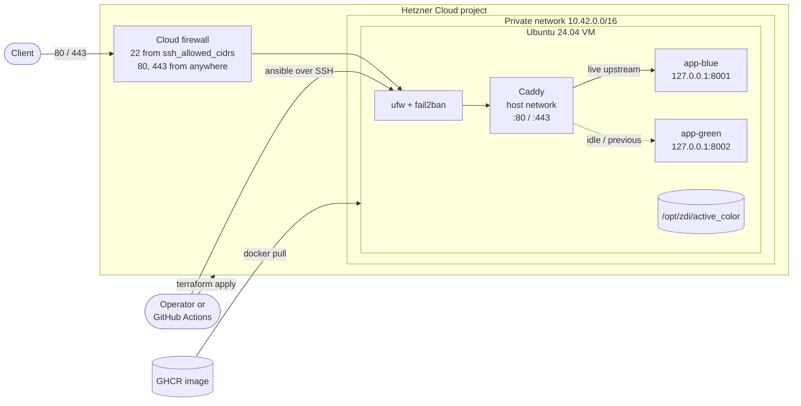
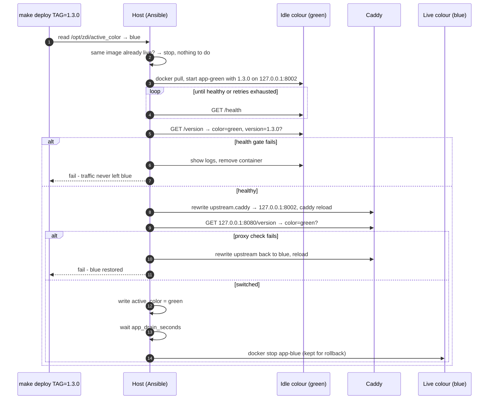

# zero-downtime-iac

[](https://github.com/Shgabnaz1377/zero-downtime-iac/actions/workflows/ci.yml)
[](LICENSE)

Infrastructure as code that provisions a cloud VM on Hetzner Cloud and ships a
containerised web app to it with **blue/green, zero-downtime releases** and
one-command rollback.

- **Terraform** creates the network, the cloud firewall, the server and its SSH
  key, then writes the Ansible inventory from its own outputs.
- **Ansible** hardens the OS, installs Docker, runs Caddy as the reverse proxy
  and performs the releases: start the idle colour, health-check it, switch the
  proxy, drain, stop the old colour.
- **GitHub Actions** lint and validate everything on every push, build and
  smoke-test the image, publish it to GHCR on a tag, and offer a manual,
  approval-gated deploy.

The sample app (FastAPI, `/health` and `/version`) is intentionally tiny: the
point is the release mechanics, and any HTTP service with a health endpoint
can take its place.

## Contents

- [Architecture](#architecture)
- [How a blue/green release works](#how-a-bluegreen-release-works)
- [Repository layout](#repository-layout)
- [Prerequisites](#prerequisites)
- [Quick start](#quick-start)
- [Day-to-day commands](#day-to-day-commands)
- [CI/CD](#cicd)
- [Configuration reference](#configuration-reference)
- [Cost](#cost)
- [Security notes](#security-notes)
- [Teardown](#teardown)
- [Limitations and next steps](#limitations-and-next-steps)

## Architecture



Two layers of firewall protect the host: the Hetzner cloud firewall (managed by
Terraform) and ufw on the VM (managed by Ansible). Both allow SSH only from
`ssh_allowed_cidrs`. The app containers publish their ports on `127.0.0.1`
only, so the sole way in from outside is through Caddy.

## How a blue/green release works

There are always two named slots on the server, **blue** and **green**. One is
live; the other holds either nothing (first release) or the previous release,
stopped. A release always goes to the slot that is *not* live.



Step by step, as implemented in
[`ansible/roles/app/tasks/release.yml`](ansible/roles/app/tasks/release.yml):

1. **Read the state.** `/opt/zdi/active_color` says which colour is live. No
   file means nothing has been released yet and the first release goes to blue.
2. **Skip no-op releases.** If the live container already runs exactly the
   requested image, the playbook stops there. Re-running a deploy is safe.
3. **Pull and start the idle colour.** The new image starts as
   `zdi-app-<idle>` on its own loopback port, with `APP_VERSION` and
   `APP_COLOR` set, a read-only root filesystem, all capabilities dropped and a
   memory limit. Any stale container in that slot is replaced.
4. **Health gate.** Ansible polls `GET /health` directly on the new container
   (not through the proxy) until it returns 200, for up to
   `app_health_retries × app_health_delay` seconds (60 s by default). It then
   calls `/version` and checks that the colour and version are the ones it just
   started, which rules out talking to a leftover process.
5. **Abort before the switch if unhealthy.** If the gate fails, Ansible prints
   the container's last 50 log lines, removes it and fails. The proxy was never
   touched, so users never saw the broken version.
6. **Switch.** Ansible rewrites `/opt/zdi/caddy/upstream.caddy` to point at
   the new port and runs `caddy reload`. Caddy swaps its configuration in
   place: connections already open finish against the old upstream, new
   requests go to the new one, and the listening sockets are never closed.
   `lb_try_duration` lets a request that lands mid-reload retry for a few
   seconds instead of failing.
7. **Verify through the proxy.** A loopback-only Caddy listener
   (`127.0.0.1:8080`) serves the same upstream without depending on DNS or TLS.
   Ansible checks that `/version` there now reports the new colour. If it does
   not, the upstream is switched back, the new container is removed and the
   release fails with the old version still serving.
8. **Record, drain, stop.** The new colour is written to `active_color`, the
   play waits `app_drain_seconds` for long-running requests, then the old
   colour is **stopped but not removed**.

**Rollback** ([`rollback.yml`](ansible/roles/app/tasks/rollback.yml)) reverses
the last switch: it starts the stopped container of the other colour (no image
pull, so it takes seconds), runs the same health gate, switches Caddy, records
the state and stops the colour that was live. Running rollback a second time
returns to the release you rolled back from. Rehearse a failed release with
`app_env: {APP_FAIL_HEALTH: "1"}`: the new container never becomes healthy and
the deploy must abort with the old version still live.

What "zero downtime" covers here, and what it does not:

- Releases and rollbacks of the app: no dropped requests, because the proxy
  only ever points at a container that has already passed its health check.
- Changing Docker's daemon config: `live-restore` keeps containers running
  while dockerd restarts.
- **Not** covered: recreating the Caddy container itself (a new
  `app_caddy_image`), kernel reboots, or losing the single VM. Those need a
  second server behind a load balancer; see
  [Limitations](#limitations-and-next-steps).

## Repository layout

```text
.
├── terraform/                 # Hetzner Cloud infrastructure
│   ├── main.tf                # wires the modules, renders the Ansible inventory
│   ├── variables.tf           # inputs with validation
│   ├── outputs.tf
│   ├── backend.tf             # optional remote state (commented out)
│   ├── terraform.tfvars.example
│   ├── templates/inventory.yml.tftpl
│   └── modules/
│       ├── network/           # private network + subnet
│       ├── firewall/          # cloud firewall (22 restricted, 80/443 open)
│       └── server/            # VM, cloud-init bootstrap
├── ansible/
│   ├── site.yml               # provision: common + docker + app (Caddy)
│   ├── deploy.yml             # blue/green release (-e app_image_tag=...)
│   ├── rollback.yml           # switch back to the previous colour
│   ├── status.yml             # what is live, what each colour holds
│   ├── group_vars/            # all.yml, app.yml
│   ├── inventory/             # hosts.yml is generated by Terraform
│   └── roles/
│       ├── common/            # users, SSH hardening, unattended upgrades, ufw
│       ├── docker/            # Docker Engine + Compose plugin
│       └── app/               # Caddy + blue/green release logic
├── app/                       # sample FastAPI service, tests, Dockerfile
├── .github/workflows/         # ci.yml, image.yml, deploy.yml
└── Makefile
```

## Prerequisites

| Tool | Version | Used for |
| --- | --- | --- |
| Terraform | >= 1.6 | provisioning |
| Python | >= 3.11 | Ansible and the app tests |
| ansible-core | 2.15+ (CI uses 2.21) | configuration and releases |
| make, bash | any | the convenience targets |
| tflint, ansible-lint, yamllint | see `requirements-lint.txt` | `make lint` (optional) |

You also need:

- A Hetzner Cloud project and an API token with read/write permission
  (Console → Security → API tokens).
- An SSH key pair. The public key goes into `terraform.tfvars`.
- Your public IP address, for `ssh_allowed_cidrs`.
- A published image. Pushing a `v*.*.*` tag runs the
  [image workflow](.github/workflows/image.yml) and publishes
  `ghcr.io/<owner>/zero-downtime-iac-app:<version>`. Make the package public,
  or set `app_registry_username` / `app_registry_password` (see
  [Configuration](#configuration-reference)).

Ansible's control node does not run natively on Windows. Use WSL, Linux or
macOS.

## Quick start

```bash
# 1. Credentials and settings
export TF_VAR_hcloud_token="<your Hetzner API token>"
cp terraform/terraform.tfvars.example terraform/terraform.tfvars
$EDITOR terraform/terraform.tfvars        # public key, ssh_allowed_cidrs, ...

# 2. Infrastructure (also writes ansible/inventory/hosts.yml)
make init
make plan
make apply

# 3. OS baseline, Docker and Caddy (cloud-init needs ~1 minute on first boot)
pip install ansible-core
make provision

# 4. First release, then another one
make deploy TAG=1.0.0
make deploy TAG=1.1.0

# 5. Look at it
curl "$(terraform -chdir=terraform output -raw app_url)/version"
make status
```

To watch a switch happen, run this in a second terminal during
`make deploy`; the colour flips with no failed requests:

```bash
URL="$(terraform -chdir=terraform output -raw app_url)"
while true; do curl -s -o /dev/null -w "%{http_code} " "$URL/health"; curl -s "$URL/version"; echo; sleep 0.2; done
```

## Day-to-day commands

| Command | What it does |
| --- | --- |
| `make plan` / `make apply` | Preview / apply infrastructure changes |
| `make provision` | Re-apply OS hardening, Docker and Caddy (idempotent, does not touch the live release) |
| `make deploy TAG=x` | Blue/green release of `x` |
| `make rollback` | Back to the previous colour; run again to roll forward |
| `make status` | Live colour, the image in each slot and what the proxy serves |
| `make lint` | yamllint, ansible-lint, terraform fmt/validate, tflint |
| `make test` | App unit tests |
| `make destroy` | Delete all cloud resources |

## CI/CD

| Workflow | Trigger | Jobs |
| --- | --- | --- |
| [`ci.yml`](.github/workflows/ci.yml) | push to `main`, pull requests | `terraform fmt -check`, `terraform init -backend=false` + `validate`, tflint; yamllint, ansible-lint (production profile), playbook syntax checks; pytest; Docker build plus a smoke test of `/health` and `/version` |
| [`image.yml`](.github/workflows/image.yml) | tag `v*.*.*`, manual | Multi-arch build, push to GHCR as `<version>` and `sha-<short>` using the built-in `GITHUB_TOKEN` |
| [`deploy.yml`](.github/workflows/deploy.yml) | manual only | `deploy` / `rollback` / `status` against the server, in the `production` environment |

The deploy workflow refuses to run until these secrets exist:

| Secret | Value |
| --- | --- |
| `DEPLOY_HOST` | `terraform output -raw server_ipv4` |
| `DEPLOY_SSH_KEY` | a private key whose public half is authorised on the server |
| `DEPLOY_KNOWN_HOSTS` | the server's host key, from `ssh-keyscan -t ed25519 <host>` after checking its fingerprint against the server console |
| `REGISTRY_USERNAME`, `REGISTRY_TOKEN` | optional, only for a private image |

Add required reviewers to the `production` environment to make every release
an approved one. Note that the runner must be able to reach port 22. Because
SSH is restricted to `ssh_allowed_cidrs`, either run the job on a self-hosted
runner inside an allowed network (set the repository variable
`DEPLOY_RUNNER` to its label) or deliberately add the runner's egress range.

## Configuration reference

Terraform inputs (`terraform/variables.tf`, all validated):

| Variable | Default | Notes |
| --- | --- | --- |
| `hcloud_token` | required | sensitive; pass via `TF_VAR_hcloud_token` |
| `ssh_public_key` | required | one OpenSSH public key line |
| `ssh_allowed_cidrs` | required | `0.0.0.0/0` and `::/0` are rejected |
| `name`, `environment` | `zdi`, `staging` | resource names are `<name>-<environment>-...` |
| `location`, `network_zone` | `fsn1`, `eu-central` | |
| `server_type`, `image` | `cx22`, `ubuntu-24.04` | |
| `app_domain` | `""` | set it to a DNS name pointing at the server for automatic HTTPS |
| `enable_backups` | `false` | |

Ansible variables (`ansible/group_vars/` and role defaults):

| Variable | Default | Notes |
| --- | --- | --- |
| `app_image_repository` | `ghcr.io/shgabnaz1377/zero-downtime-iac-app` | |
| `app_image_tag` | required for deploy | validated against the image tag grammar |
| `app_env` | `{LOG_LEVEL: info}` | extra container environment |
| `app_health_retries` / `app_health_delay` | `20` / `3` | the health gate budget |
| `app_drain_seconds` | `10` | how long the old colour keeps running after the switch |
| `app_acme_email` | `""` | ACME account email when `app_domain` is set |
| `app_registry_username` / `app_registry_password` | `""` | for private images; keep the password in Ansible Vault |
| `common_admin_users` | `[]` | extra users with SSH keys and sudo |
| `common_unattended_reboot` | `false` | allow automatic reboots after security updates |

## Cost

With the defaults the stack creates one CX22 server (2 vCPU, 4 GB RAM) with a
public IPv4 address, plus a private network and a firewall, which cost nothing
extra. At the time of writing that is roughly **€4–5 per month**, billed
hourly, so a test run of an afternoon costs a few cents. Enabling backups adds
20% of the server price. Check
[Hetzner's current pricing](https://www.hetzner.com/cloud/) before you apply,
and run `make destroy` when you are done.

## Security notes

- **Secrets stay out of git.** `*.tfvars`, state files, `.terraform/` and the
  generated inventory are ignored. The API token is read from
  `TF_VAR_hcloud_token`; it is marked `sensitive` and never printed.
- **Terraform state is sensitive.** The token is not stored in it, but
  addresses and resource details are. Keep it local, or use an encrypted, access-controlled
  remote backend sketched in `terraform/backend.tf`.
- **SSH** is reachable only from `ssh_allowed_cidrs`, enforced twice (cloud
  firewall and ufw). Root login and passwords are disabled, only public keys
  are accepted, `AllowUsers` limits logins to the admin users, forwarding is
  off and fail2ban bans repeated failures.
- **Host keys.** The first Ansible connection uses
  `StrictHostKeyChecking=accept-new` (trust on first use). For stronger
  guarantees, compare the fingerprint with the one in the Hetzner console
  before the first run. CI uses a pinned `known_hosts`.
- **Containers** run as an unprivileged user with a read-only root filesystem,
  `cap_drop: ALL`, `no-new-privileges` and a memory limit. App ports are bound
  to `127.0.0.1`; Docker-published ports bypass ufw, which is why nothing is
  published on a public interface.
- **The docker group is root-equivalent**, so nobody is added to it; Ansible
  uses sudo.
- **Updates.** Unattended upgrades install security updates daily. Docker
  packages are excluded so that engine upgrades happen deliberately during a
  provisioning run.
- **CI** uses least-privilege `permissions`, passes workflow inputs through
  environment variables rather than interpolating them into scripts, validates
  the image tag, and deletes the SSH key at the end of the job.

## Teardown

```bash
make destroy                        # deletes the server, network, firewall and SSH key
rm -f ansible/inventory/hosts.yml   # if Terraform did not already remove it
```

Images in GHCR are not affected; delete them under the repository's
*Packages* if you no longer need them. If you enabled the remote backend,
the state bucket is yours to remove too.

## Limitations and next steps

- **One server is one failure domain.** Blue/green removes release downtime,
  not hardware or reboot downtime. The next step is two servers in a Hetzner
  load balancer, released one at a time (`deploy.yml` already uses
  `serial: 1`).
- **Stateless apps only.** Database schema changes need to be backward
  compatible across one release (expand, release, then contract) so that both
  colours can run against the same schema during a switch and a rollback.
- **Health means "the process answers".** Point `app_health_path` at an
  endpoint that checks real dependencies if your service has them.

## License

[MIT](LICENSE)
